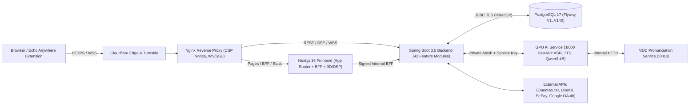

# English Coach (Echo Ocean)

**English Coach** is a full-stack, AI-assisted English learning platform featuring structured IELTS/TOEIC exam preparation, real-time bilingual voice coaching (**Echo JARVIS**), phoneme-level pronunciation analysis (**MDD V2.2**), spaced-repetition flashcards (**SM-2**), bilingual reading & dictation studios, competitive multiplayer games, and interactive 3D WebGL2 worlds (**Study Space** & **Speaking Arena**).

- **Live Application:** [https://englishcoach.io.vn](https://englishcoach.io.vn)
- **Repository Policy:** Strict source-only codebase (application source, database schema migrations, build recipes, tests, and documentation). Runtime datasets, examination media, dictionary databases, and AI model weights are provisioned externally — see [External Resources Manifest](docs/operations/external-resources.md).

---

## Implemented Capabilities

| Domain | Key Capabilities |
|---|---|
| **Exams & Assessment** | IELTS & TOEIC CBT runner, asynchronous scoring workers (`ExamJobWorker`), rubric grading, psychometric measurement, and exam administration |
| **Speaking & Pronunciation** | AI roleplay, topic practice, `4×3` paginated Shadowing catalog, 3-tab Liquid Glass Speaking Profile, phoneme-level MDD V2.2 scoring, and single-use V140 receipt integrity |
| **Echo JARVIS Voice Coach** | Full-duplex binary/JSON WebSocket voice (`/ws-card-blast/echo-voice`), Zero-WASM DSP worker (PBFDAF AEC + Silero VAD v5 + INT8 wake-word), `207/207` FE/BE fast-path intent parity, `23` grounded read/action tools with CaMeL security predicates, and 3-tier LLM failover |
| **Reading, Books & Dictionary** | Bilingual reader, My Books PDF/EPUB reader, offline EN-VI lexical dictionary with V102 per-user isolation, and zero-passive-AI selection tools |
| **Listening & Dictation** | YouTube WhisperX transcription & forced alignment, synchronized dictation studio, and local ONNX EN-VI browser translator worker |
| **Writing Studio** | Essay coaching, LanguageTool grammar checks, sentence/paragraph translation practice (`Cơ bản` / `Nâng cao`), and structured draft grading |
| **Flashcards & Vocabulary** | SM-2 spaced repetition with idempotent review guards, `.apkg` import, curated CEFR/TOEIC/IELTS topic decks, and Neural Cosmos lexical graph |
| **Games & Multiplayer** | Card Blast PvP (STOMP/WebSocket), Echo Quiz Rush (server-authoritative netcode), King of English, Hangman, Word Chain, Echo Spelling, and Echo Sentinel anti-cheat |
| **3D Worlds & Companions** | Study Space / Echo Life (Three.js WebGL2, Rapier3D physics worker, 31-zone city streaming), Speaking Arena Archipelago (LiveKit WebRTC spatial voice), Echo Odyssey, and Background Studio |
| **Platform & Extensions** | HttpOnly cookie BFF auth, Google OAuth, WebAuthn/TOTP admin MFA, SePay VietQR Premium billing & AI quota metering, Community/Messenger, Leaderboards/Proficiency, and **Echo Anywhere** Chrome MV3 extension |

---

## Technology Stack

| Layer | Technology |
|---|---|
| **Backend** | Java 21, Spring Boot 3.5.16, Spring Security, Spring Data JPA + Spring JDBC, Flyway (`V1`–`V140`), STOMP/WebSocket, PostgreSQL 17 |
| **Frontend** | Next.js 16.4.5 (App Router), React 19.2.8, TypeScript, Tailwind CSS, Three.js / WebGL2, Rapier3D (WASM Worker), LiveKit Client |
| **AI & Speech Services** | Python 3.11+, FastAPI, `faster-whisper` (CUDA `int8_float16`), WhisperX, Kokoro-82M (CUDA EN TTS), VieNeu-TTS-v3-Turbo (CPU ONNX INT8 VI TTS), `llama-cpp-python` (`Qwen3-4B-Instruct` GGUF CPU Tier-3 failover), Smart Turn v3.2, MDD V2.2 (`:8010`) |
| **Infrastructure & Edge** | Docker & Docker Compose, Nginx (per-request nonce CSP, SSE/WS unbuffered proxy), Cloudflare Edge & Turnstile, Azure PostgreSQL 17 |
| **Browser Extension** | Chrome Manifest V3 (`extension/echo-anywhere`) with PKCE pairing and scoped API access |

---

## System Architecture Overview



Detailed diagrams, module dependency rules, and traced end-to-end flows live in [`docs/architecture/overview.md`](docs/architecture/overview.md) and [`docs/architecture/backend-layering.md`](docs/architecture/backend-layering.md).

---

## Repository Structure

```text
english-coach/
├── .github/                  # Isolated CI workflows, PR & issue templates
├── backend/                  # Spring Boot 3.5 / Java 21 feature-sliced layered monolith
│   ├── src/main/java/        # 42 domain modules under com.englishcoach.*
│   ├── src/main/resources/   # application.yml, Flyway V1..V140 migrations, seed data
│   ├── src/test/             # JUnit 5 unit, security, architecture guard & PG17 tests
│   └── pom.xml
├── frontend/                 # Next.js 16 / React 19 / TypeScript application
│   ├── src/                  # App Router pages, feature components, hooks, services, 3D/DSP
│   ├── public/               # Provenance-verified UI, DSP worker, and Echo Life 3D assets
│   ├── scripts/              # Maintained contract & regression test runners
│   └── package.json
├── ai-service/               # FastAPI AI & speech inference worker + pytest suite
├── extension/                # Echo Anywhere Chrome MV3 browser extension
├── shared/                   # Cross-stack contracts (207-case Echo JARVIS fast-path fixtures)
├── deploy/                   # Production Dockerfiles, Nginx config, and operational scripts
├── infra/                    # Local development Docker Compose & DB runbooks
├── scripts/                  # Build, extraction, grammar/asset tooling, and CI hygiene checks
├── tools/                    # Auxiliary SEO / Lighthouse verification CLI (echo-discover)
├── docs/                     # Architecture, database ERD, developer guide, ops & attribution
├── .env.production.example   # Sanitized production environment template (no secrets)
├── docker-compose.prod.yml   # Production VPS container specification
├── CONTRIBUTING.md           # Contribution workflow, layering rules & hygiene policy
└── SECURITY.md               # Security controls and responsible disclosure policy
```

---

## Quick Start

### Prerequisites
- **Java 21+** and **Apache Maven 3.9+**
- **Node.js 24+** and **npm 11+**
- **Python 3.11+** and **pytest**
- **PostgreSQL 17** (or Docker Desktop for local database containers)

### 1. Backend (Spring Boot)
```bash
cd backend
mvn -B test-compile
mvn test -Dtest=ArchitectureLayeringGuardTest,Wave3RemediationBehaviorTest
```

### 2. Frontend (Next.js 16)
```bash
cd frontend
npm ci
npx tsc --noEmit
npm run test:security
npm run test:echo-jarvis
npm run test:wave-b-ux
```

### 3. AI Service (FastAPI)
```bash
cd ai-service
pytest app/tests/test_security_hardening.py app/tests/test_echo_local_llm.py app/tests/test_ipa_hardening.py -q
```

### 4. Repository Hygiene & Asset Provenance Checks
```bash
python scripts/ci/repo_hygiene_check.py
node docs/echo-life/aaa-evolution/scripts/verify-asset-provenance.cjs --strict
```

Full local environment setup, external dataset/model provisioning, and build instructions are documented in [`docs/development/developer-guide.md`](docs/development/developer-guide.md) and [`docs/operations/external-resources.md`](docs/operations/external-resources.md).

---

## Documentation Index

- **Architecture & UML:** [`docs/architecture/overview.md`](docs/architecture/overview.md) · [`docs/architecture/backend-layering.md`](docs/architecture/backend-layering.md) · [`docs/architecture/adr.md`](docs/architecture/adr.md)
- **Database & Migrations:** [`docs/database/schema-and-migrations.md`](docs/database/schema-and-migrations.md)
- **Development & Testing:** [`docs/development/developer-guide.md`](docs/development/developer-guide.md)
- **Operations & External Resources:** [`docs/operations/deployment-and-recovery.md`](docs/operations/deployment-and-recovery.md) · [`docs/operations/external-resources.md`](docs/operations/external-resources.md)
- **Governance & Attribution:** [`CONTRIBUTING.md`](CONTRIBUTING.md) · [`SECURITY.md`](SECURITY.md) · [`docs/ATTRIBUTION.md`](docs/ATTRIBUTION.md)
