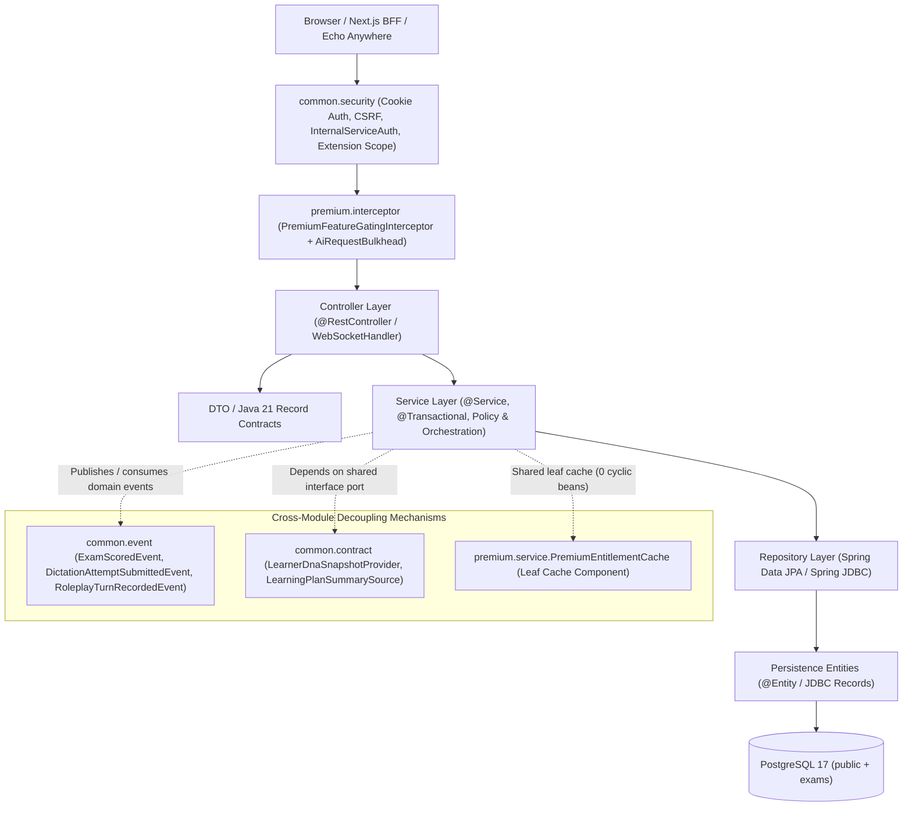
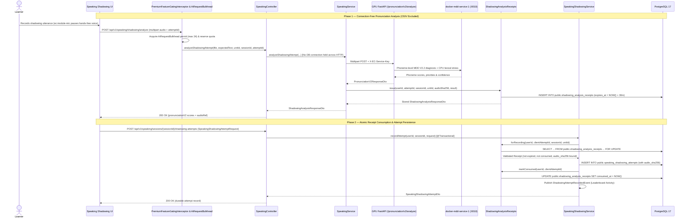
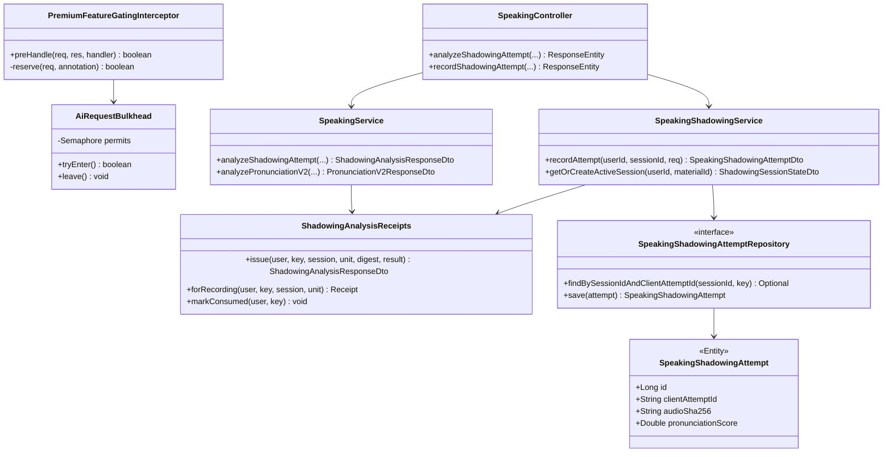
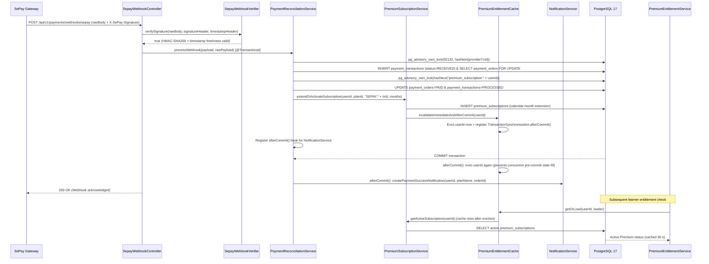
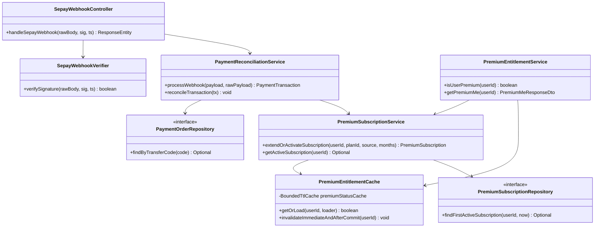

# Backend Architecture, Layering & End-to-End Flows

> **Scope:** Authoritative architectural guide to the Spring Boot `3.5.16` / Java `21` backend under `backend/src/main/java/com/englishcoach/` (`42` top-level packages), including module ownership, enforced layering boundaries, traced end-to-end business flows with UML diagrams, automated guardrails, and remaining technical debt.

---

## 1. Architectural Style & Module Taxonomy

The backend is organized as a **Feature-Sliced Layered Monolith**. Business capabilities are partitioned into `42` top-level domain packages under `com.englishcoach.*`. Within standard feature slices, classes follow a strict unidirectional flow (`controller -> dto -> service -> repository -> entity`). Two complex domains intentionally adopt specialized internal architectures (`garden` uses Clean/DDD slices; `exams` uses Spring JDBC repositories with an asynchronous lease-based job worker), and `ai` implements a multimodal agentic router with `23` allow-listed tools.

### Complete 42-Package Ownership & Style Matrix

| Category | Top-Level Package (`com.englishcoach.*`) | Internal Structure / Subpackages | Primary Ownership |
|---|---|---|---|
| **Shared Kernel (1)** | `common` | `ai`, `cache`, `config`, `contract`, `event`, `exception`, `scheduling`, `security`, `web` | Cross-cutting security filters, CORS (`CorsConfig`), selective OSIV (`OpenEntityManagerInViewConfig`), shared contracts/events, TTL caches, global exception handling |
| **Standard Layered MVC (20)** | `auth` | `controller`, `dto`, `entity`, `mail`, `mfa`, `policy`, `repository`, `service` | User identity, sessions, Google OAuth, email verification, WebAuthn/TOTP admin MFA, rate-limit buckets |
| | `avatarframe` | `controller`, `dto`, `entity`, `evaluator`, `repository`, `service` | Prestige avatar frames and `11` strategy evaluators (`PrestigeEvaluationEngine`) |
| | `coach` | `controller`, `dto`, `entity`, `repository`, `service` | Structured learning plan persistence (`learning_plans`) |
| | `community` | `controller`, `dto`, `entity`, `repository`, `scheduler`, `service` | Community posts, comments, multi-media attachments, reactions, follows, moderation audit records |
| | `content` | `config`, `controller`, `dto`, `entity`, `repository`, `service` | Content Hub, BBC/Guardian RSS ingestion, shared reading/listening/YouTube catalog |
| | `dictionary` | `controller`, `dto`, `entity`, `provider`, `repository`, `service` | Offline SQLite EN-VI lexical lookup (`LocalEnViLexicalProvider`) and V102 owner-scoped learner entries |
| | `echocoach` | `controller`, `dto`, `entity`, `repository`, `service` | Persistent Echo Coach chat session and message history |
| | `feedback` | `controller`, `dto`, `entity`, `repository`, `security`, `service` | Learner feedback threads, admin replies, and post-commit STOMP badge broadcasts |
| | `flashcard` | `controller`, `dto`, `entity`, `memory`, `pvp`, `repository`, `service` | SM-2 spaced repetition, `.apkg` import, curated topic/exam decks, Memory Tides, Card Blast PvP (`STOMP`) |
| | `listening` | `config`, `controller`, `dto`, `entity`, `repository`, `service` | YouTube WhisperX import jobs, synchronized transcripts, dictation exercises, checkpoints, translation cache |
| | `mocktest` | `controller`, `dto`, `entity`, `repository`, `service` | Legacy mock exam read/history endpoints (DTO-wrapped; legacy submit retired with `410 GONE`) |
| | `notification` | `config`, `controller`, `dto`, `entity`, `event`, `listener`, `repository`, `scheduler`, `service` | In-app notifications, per-user read states, and event-driven delivery |
| | `payment` | `config`, `controller`, `dto`, `entity`, `product`, `repository`, `service`, `worker` | SePay VietQR order generation, HMAC-SHA256 webhook verification, idempotent reconciliation, product settlement |
| | `premium` | `admin`, `config`, `controller`, `dto`, `entity`, `exception`, `interceptor`, `promo`, `repository`, `service`, `voucher` | Subscription lifecycle, `PremiumEntitlementCache`, `@RequirePremiumAi` gating, `AiRequestBulkhead`, AI vouchers |
| | `progress` | `config`, `controller`, `dto`, `repository`, `service` | Cross-skill learning progress and activity streak summaries |
| | `reading` | `controller`, `dto`, `entity`, `exception`, `repository`, `service` | Bilingual reading studio, My Books document/PDF import, contextual explanations, highlights |
| | `speaking` | `arena`, `config`, `controller`, `dto`, `entity`, `profile`, `repository`, `seeder`, `service`, `shadowing`, `topic` | Shadowing `4×3` catalog, MDD V2.2 pronunciation & V140 receipts, roleplay, topic practice, Speaking Profile, Arena, TTS |
| | `user` | `controller`, `dto`, `entity`, `repository`, `service` | Learner profile settings, avatar storage, heatmap/theme preferences, public display-name sanitization |
| | `vocabulary` | `controller`, `dto`, `entity`, `repository`, `service` | Vocabulary courses and course wordlists (DTO-wrapped service layer) |
| | `writing` | `client`, `config`, `controller`, `dto`, `entity`, `enums`, `exception`, `repository`, `service`, `translation` | Essay sessions, LanguageTool checks, draft grading, sentence & paragraph translation pools (`Cơ bản` / `Nâng cao`) |
| **Sub-Domain Layered (2)** | `leaderboard` | `activity`, `board` | Activity point ledger, debounced materialized-view ranking refresh (`mv_activity_rank`) |
| | `proficiency` | `api`, `board`, `model`, `placement` | CEFR proficiency estimation, placement assessments, `mv_proficiency_rank` (decoupled from `leaderboard`) |
| **Intentional Specialized (3)** | `garden` | `api`, `application`, `config`, `domain`, `infra` | **DDD / Clean Slice:** Pure `domain/` simulation (`EconomySimulator`), batched `infra/GardenJdbc`, `14`-slot bulkhead |
| | `exams` | `analytics`, `client`, `config`, `content`, `controller`, `exception`, `job`, `measurement`, `media`, `model`, `operations`, `practice`, `release`, `repository`, `scoring`, `security`, `service`, `validation` | **JDBC + Async Worker:** IELTS/TOEIC CBT engine (`exams` schema), `ExamJobWorker`, psychometrics & release governance |
| | `ai` | `controller`, `dto`, `echo` (`camel`, `tools`), `service`, `voice` | **Agentic Multimodal Orchestrator:** `EchoRouter`, `EchoSpeechActAnalyzer`, `23` `EchoTool`s, `CaMeLPolicyEngine`, `EchoVoiceWebSocketHandler`, 3-tier LLM failover |
| **Compact / Flat Slices (16)** | `background`, `cosmos`, `dashboard`, `echolife`, `extension`, `grammar`, `hangman`, `kingofenglish`, `learningpath`, `messenger`, `quizrush`, `sentinel`, `spelling`, `studyspace`, `wallpaper`, `wordchain` | Single package (`dashboard` has `controller/`) | Bounded-size domains: Background Studio, Neural Cosmos, Dashboard aggregation, Echo Life (`10`-slot bulkhead), Echo Anywhere scope filter, Grammar Academy, games, Learning Path/Odyssey, Messenger, Sentinel, Study Space, Wallpaper |

---

## 2. Layering & Dependency Direction

All new backend development must preserve strict top-down dependency direction within each feature slice and use shared contracts or Spring domain events for cross-module communication.



### Mandatory Layer Contracts

1. **Controllers (`controller/`):** Handle HTTP/WebSocket binding, `@Valid` validation, `@AuthenticationPrincipal` extraction, and response status shaping. Controllers must **not** inject repositories directly, hold `@Transactional` boundaries, or return raw JPA `@Entity` instances.
2. **DTOs (`dto/`):** Immutable request/response models (prefer Java 21 `record`) that decouple wire contracts from JPA lazy proxies and prevent accidental credential or internal field leakage.
3. **Services (`service/`):** Own business invariants, authorization checks, advisory locks, and concise `@Transactional` scopes. External HTTP/AI/GPU calls must run **outside** active database transactions (paired with [`OpenEntityManagerInViewConfig`](../../backend/src/main/java/com/englishcoach/common/config/OpenEntityManagerInViewConfig.java)). Never annotate `static` methods with `@Transactional`.
4. **Repositories (`repository/`):** Encapsulate JPA queries or parameterized `JdbcTemplate` operations. Repositories must **never** depend upward on `service/`.
5. **Entities (`entity/`):** Map database schema state only. Entities must **never** import or embed `dto/` types.

---

## 3. End-to-End Business Flow Traces

### Flow A — Speaking Shadowing Pronunciation V2.2 Analysis & V140 Single-Use Receipt Settlement

This trace illustrates how English Coach protects PostgreSQL connections during slow GPU inference while guaranteeing cryptographic anti-replay integrity when persisting pronunciation attempts (`V133` + `V140`).





---

### Flow B — SePay VietQR Settlement, Advisory Locking & Post-Commit Entitlement Cache Invalidation

This trace demonstrates idempotent financial webhook reconciliation, PostgreSQL transaction-scoped advisory locking, and the acyclic leaf-cache pattern (`PremiumEntitlementCache`) that eliminates circular Spring bean dependencies between subscription writes and entitlement reads.





---

## 4. Automated Architectural Guardrails

Architecture rules are continuously enforced in JUnit 5 without requiring external bytecode tooling:

| Test Class | Enforced Invariants |
|---|---|
| [`ArchitectureLayeringGuardTest`](../../backend/src/test/java/com/englishcoach/architecture/ArchitectureLayeringGuardTest.java) | 1. Zero `com.englishcoach.proficiency -> com.englishcoach.leaderboard` imports or references.<br>2. Zero `com.englishcoach.learningpath -> com.englishcoach.ai` imports or references.<br>3. Zero `PremiumSubscriptionService -> PremiumEntitlementService` reference (leaf `PremiumEntitlementCache` required).<br>4. Zero `@Transactional` annotations on `static` methods anywhere in `src/main/java` (plus explicit reflection check on `ExamResultService`).<br>5. Zero direct Repository injection (source + reflection) in `9` remediated controllers (`CardBlastPvPController`, `SpeakingController`, `SpellingController`, `WordChainController`, `MockTestController`, `VocabularyController`, `ExamAdminController`, `ExamContentAdminController`, `ExamMeasurementController`), and zero `@Transactional` on `SpeakingController`. |
| [`Wave3RemediationBehaviorTest`](../../backend/src/test/java/com/englishcoach/architecture/Wave3RemediationBehaviorTest.java) | Verifies post-commit STOMP broadcast deferral in `FeedbackServiceImpl`, `@Transactional(readOnly = true)` on `AdminIdentityService.requireOfficialAdmin`, `Propagation.NOT_SUPPORTED` on `ReadingService.processAndSaveFile`, immediate + `afterCommit` eviction in `PremiumEntitlementCache`, `LearnerDnaSnapshotProvider` port execution, DTO JSON key parity without lazy entity leakage (`MockExamDto`, `MockExamResultDto`, `VocabularyCourseDto`, `CommunityModerationRecordDto`), and `UserProfileService.findPublicDisplayName` email sanitization. |
| [`ExamPhase5ImportArchitectureTest`](../../backend/src/test/java/com/englishcoach/exams/release/ExamPhase5ImportArchitectureTest.java) | Verifies isolation and release-governance import rules within the `exams` subsystem. |

Run the architectural guard suite locally or in CI:

```bash
cd backend
mvn test -Dtest=ArchitectureLayeringGuardTest,Wave3RemediationBehaviorTest
```

---

## 5. Practical Feature Addition Template

When introducing a new backend capability under `com.englishcoach.<feature>`:

```text
backend/src/main/java/com/englishcoach/<feature>/
├── controller/
│   └── <Feature>Controller.java        # @RestController, @Valid, @AuthenticationPrincipal, DTOs only
├── dto/
│   ├── Create<Feature>Request.java     # Java 21 record with jakarta.validation annotations
│   └── <Feature>ResponseDto.java       # Java 21 record with static fromEntity(...) mapper
├── entity/
│   └── <Feature>Entity.java            # JPA @Entity (never imports dto/)
├── repository/
│   └── <Feature>Repository.java        # JpaRepository or JdbcTemplate DAO (never imports service/)
└── service/
    └── <Feature>Service.java           # @Service, narrow @Transactional boundaries, domain validation
```

### Checklist Before Opening a PR

1. Keep external AI/HTTP calls outside `@Transactional`; if the endpoint waits on an LLM or GPU worker, register its route in [`OpenEntityManagerInViewConfig`](../../backend/src/main/java/com/englishcoach/common/config/OpenEntityManagerInViewConfig.java) and protect it with `@RequirePremiumAi` if quota-metered.
2. Add cross-module events to `com.englishcoach.common.event` or read interfaces to `com.englishcoach.common.contract` rather than introducing bidirectional module imports.
3. Defer side effects (STOMP broadcasts, cache invalidations, notifications) with `TransactionSynchronization.afterCommit()` when invoked inside a write transaction.
4. Add unit tests and extend [`ArchitectureLayeringGuardTest`](../../backend/src/test/java/com/englishcoach/architecture/ArchitectureLayeringGuardTest.java) for any new controller.

---

## 6. Inventory of Remaining Deferred Technical Debt

The following legacy items remain documented and intentionally deferred to avoid risky wire-contract regressions during stabilization releases:

| Item | Location | Current State | Remediation Plan |
|---|---|---|---|
| **Direct Repository Injection in Auth** | [`AuthController.java`](../../backend/src/main/java/com/englishcoach/auth/controller/AuthController.java) (`599` LOC) | Injects `UserRepository` and `AuthIdentityRepository` alongside `AuthService` for session/OAuth lookups. | Extract remaining lookup methods into `AuthService` with full BFF cookie/MFA integration regression coverage, then add `AuthController` to `ArchitectureLayeringGuardTest.REMEDIATED_CONTROLLERS`. |
| **Legacy `@Entity` HTTP Responses** | [`FlashcardController.java`](../../backend/src/main/java/com/englishcoach/flashcard/controller/FlashcardController.java) (`Flashcard`), [`SpeakingController.java`](../../backend/src/main/java/com/englishcoach/speaking/controller/SpeakingController.java) (`SpeakingResult`, `SpeakingSession`) | Retained on existing endpoints for exact JSON wire compatibility with deployed clients. | Introduce versioned DTO records matching exact wire fields (following the `Wave3RemediationBehaviorTest` JSON-parity pattern) and verify via frontend contract suites before swapping return types. |
| **High-Density Orchestration Services** | `CardBlastPvPService.java` (`2,585` LOC), `EchoVoiceWebSocketHandler.java` (`2,353` LOC), `OpenRouterChatServiceImpl.java` (`1,818` LOC), `WritingSessionServiceImpl.java` (`1,573` LOC), `SpeakingService.java` (`1,127` LOC) | Functionally cohesive and heavily tested, but long single files increase cognitive load for onboarding engineers. | Incrementally decompose into focused package-private collaborators (e.g., match-state transitions, WS frame codec, failover router) while keeping public entrypoints unchanged. |
| **Multi-Generation Package Symmetry** | `coach` + `echocoach` + `ai`; `studyspace` + `echolife`; `wallpaper` + `background` | Separate top-level packages retained to preserve JPA entity scanning and avoid cross-module churn. | Consolidate under unified domain roots only when dedicated schema/API refactoring windows are scheduled. |
