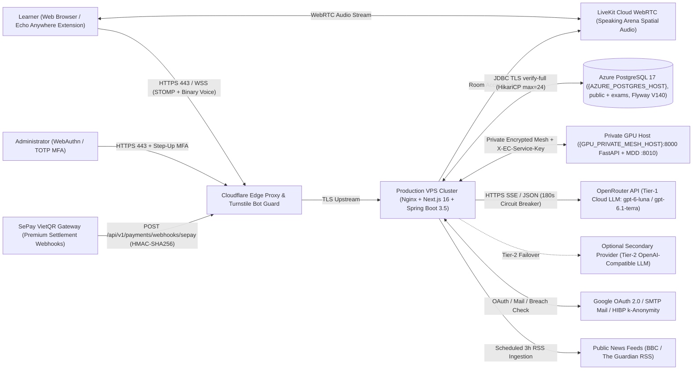
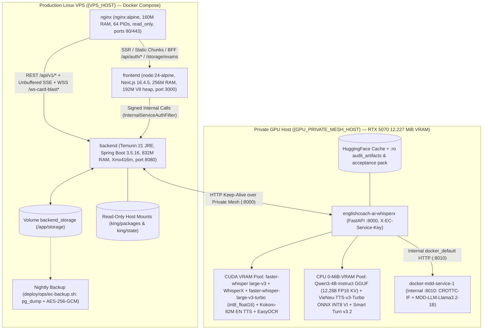
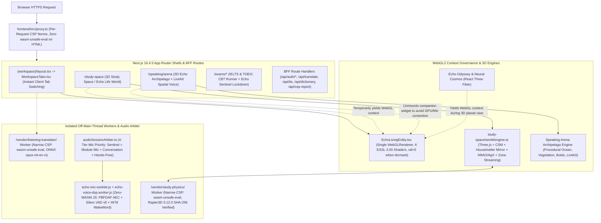
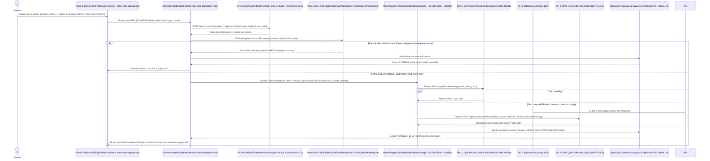

# English Coach — System Architecture Overview

> **Scope:** Production architecture of **English Coach (Echo Ocean)** (`https://englishcoach.io.vn`), reflecting the Spring Boot 3.5 / Java 21 backend (`42` top-level domain packages), Next.js 16.4.5 / React 19 frontend, private RTX 5070 GPU inference cluster (`englishcoach-ai-whisperx` + `docker-mdd-service-1`), Azure PostgreSQL 17 (`public` + `exams`, Flyway `V1`–`V140`), and the **Echo Anywhere** Chrome Manifest V3 extension.

---

## 1. System Context

English Coach is a full-stack AI-assisted English learning platform combining structured IELTS/TOEIC CBT examination preparation, real-time bilingual voice coaching (**Echo JARVIS**), phoneme-level pronunciation diagnosis (**MDD V2.2**), SM-2 spaced-repetition flashcards, bilingual reading and dictation studios, competitive multiplayer games, and interactive WebGL2 3D environments (**Study Space** and **Speaking Arena**).

**Primary configuration references:** [`docker-compose.prod.yml`](../../docker-compose.prod.yml), [`deploy/nginx/default.conf`](../../deploy/nginx/default.conf), [`deploy/ai/docker-compose.gpu.yml`](../../deploy/ai/docker-compose.gpu.yml), and [`backend/src/main/resources/application.yml`](../../backend/src/main/resources/application.yml).

---

## 2. Container & GPU/CPU Allocation Topology

Production separates stateless web serving, transactional business logic, and heavy neural inference across two host tiers connected exclusively over a private encrypted mesh network. On the RTX 5070 (`12,227 MiB` VRAM) GPU host, neural workloads are explicitly partitioned between CUDA VRAM and host CPU (`0 MiB` VRAM) so continuous speech synthesis, ASR, local LLM failover, and phoneme scoring coexist without out-of-memory contention.

### Key Resource Isolation Controls

- **Backend cgroup discipline (`832M`):** Runs with `-Xms192m -Xmx416m -XX:NewRatio=3 -XX:+UseSerialGC -XX:TieredStopAtLevel=1 -XX:ReservedCodeCacheSize=96m -XX:MaxMetaspaceSize=256m -XX:MaxDirectMemorySize=64m -Xss512k`, `MALLOC_ARENA_MAX=2`, Tomcat `max-threads=128`, and a zero-Python Bash `/dev/tcp` healthcheck.
- **Frontend secret minimization (`256M`):** Does not mount `.env.production`. Receives only `NEXTAUTH_*`, Google OAuth client credentials, `NEXT_PUBLIC_TURNSTILE_SITE_KEY`, and `APP_SECURITY_INTERNAL_SERVICE_KEY`; never receives database, JWT signing, payment, mail, MFA encryption, or LLM API secrets.
- **Zero-VRAM CPU coexistence:** `echo_local_llm.py` (`echo-local-llm-v3`) pins `n_gpu_layers=0`, `n_ctx=12288`, native `FP16` KV cache (`flash_attn=False`), `n_batch=512`, `threads=12/16`, while `VieNeu-TTS-v3-Turbo` runs on CPU ONNX INT8, preserving full CUDA VRAM headroom for WhisperX, `faster-whisper-large-v3-turbo`, `Kokoro-82M`, and `docker-mdd-service-1`.

---

## 3. Frontend Architecture: Next.js 16, Single-Context WebGL2 & Isolated Workers

The frontend combines server-rendered App Router pages, a security-hardened Backend-for-Frontend (BFF) layer, a single-renderer 3D companion entity, two full-screen 3D learning worlds, and three off-main-thread Web Workers governed by strict Content Security Policy boundaries.

**Verified source entrypoints:**
- Per-request CSP nonce middleware: [`frontend/src/proxy.ts`](../../frontend/src/proxy.ts)
- Companion 3D entity: [`frontend/src/components/features/coach/entity/EchoLivingEntity.tsx`](../../frontend/src/components/features/coach/entity/EchoLivingEntity.tsx)
- Study Space 3D engine: [`frontend/src/components/study-space/world/engine.ts`](../../frontend/src/components/study-space/world/engine.ts)
- Zero-WASM Voice DSP worker & AudioWorklet: [`frontend/public/echo-jarvis/echo-voice-dsp.worker.js`](../../frontend/public/echo-jarvis/echo-voice-dsp.worker.js), [`frontend/public/echo-mic-worklet.js`](../../frontend/public/echo-mic-worklet.js)
- Audio session priority arbiter: [`frontend/src/lib/echo-jarvis/audio/audioSessionArbiter.ts`](../../frontend/src/lib/echo-jarvis/audio/audioSessionArbiter.ts)

---

## 4. Echo JARVIS 3-Plane Voice & 3-Tier LLM Failover Flow

Echo JARVIS divides voice interaction into three deterministic/agentic execution planes — local DSP (`Plane 0`), deterministic zero-LLM navigation/control (`Plane A`), and grounded tool-augmented LLM reasoning (`Plane B`) — backed by a 3-tier resilient LLM failover chain so transient external relay errors never break live voice sessions.

### Shared Deterministic Fast-Path & Tool Governance

- **FE/BE Parity (`207/207` fixtures):** [`shared/echo-jarvis/fast-path-parity-fixtures.json`](../../shared/echo-jarvis/fast-path-parity-fixtures.json) enforces identical classification across [`fastPathCompiler.ts`](../../frontend/src/lib/echo-jarvis/intents/fastPathCompiler.ts) / [`speechActAnalyzer.ts`](../../frontend/src/lib/echo-jarvis/intents/speechActAnalyzer.ts) / [`salienceTracker.ts`](../../frontend/src/lib/echo-jarvis/intents/salienceTracker.ts) and [`EchoVoiceFastPathMatcher.java`](../../backend/src/main/java/com/englishcoach/ai/voice/EchoVoiceFastPathMatcher.java) / [`EchoSpeechActAnalyzer.java`](../../backend/src/main/java/com/englishcoach/ai/echo/EchoSpeechActAnalyzer.java) / [`EchoRouter.java`](../../backend/src/main/java/com/englishcoach/ai/echo/EchoRouter.java). Negations, deferrals, metalinguistic mentions, and conditionals produce zero false actions.
- **23 Allow-Listed Tools & CaMeL Guardrails:** [`EchoToolRegistry`](../../backend/src/main/java/com/englishcoach/ai/echo/EchoToolRegistry.java) validates every tool call against strict JSON Schemas (`additionalProperties: false`, forbidden parameter names rejected at startup), bounded per-turn budgets, [`TurnProvenance`](../../backend/src/main/java/com/englishcoach/ai/echo/camel/TurnProvenance.java), [`CaMeLPolicyEngine`](../../backend/src/main/java/com/englishcoach/ai/echo/camel/CaMeLPolicyEngine.java), and single-use confirmation tokens ([`EchoConfirmations`](../../backend/src/main/java/com/englishcoach/ai/echo/EchoConfirmations.java)).

---

## 5. Service Boundaries (AI, Voice, Pronunciation, Multiplayer & Real-Time)

| Subsystem | Runtime & Location | Protocol & Endpoint | Authentication & Security | Concurrency / Resilience Controls |
|---|---|---|---|---|
| **Core REST API & BFF Auth** | Spring Boot 3.5 (`backend:8080`) + Next.js BFF (`frontend:3000`) | HTTPS `/api/v1/*`, `/api/auth/*` | HttpOnly session cookies, CSRF (`ec.csrf`), HMAC-signed `InternalServiceAuthFilter`, WebAuthn/TOTP Admin MFA | Tomcat `max=128`, HikariCP `max=24`, Nginx rate limits (`auth_actions`, `exams_practice_scopes`, `public_proxy`) |
| **Echo JARVIS Realtime Voice** | Spring Boot WebSocket (`EchoVoiceWebSocketHandler`) | WSS `/ws-card-blast/echo-voice` (JSON + `0x01`/`0x02` binary PCM) | Session cookie + Origin check + `EchoVoiceThrottleService` | Plane-A zero-LLM bypass, 3-tier LLM failover, sliding `TurnWatchdog`, barge-in truncation |
| **GPU Speech & Local LLM** | FastAPI (`englishcoach-ai-whisperx:8000`) | HTTP over private mesh (`/api/v1/coach/*`, `/api/v1/tts/*`, `/api/v1/listening/*`, `/pronunciation/v2/*`, `/api/v1/ocr/*`) | `X-EC-Service-Key` fail-closed (`503` if unset); open probes limited to `/api/v1/health` and `/api/v1/listening/capabilities` | `AiRequestBulkhead` (`24` permits), `SpeakingTtsService` concurrency gate, `echo_local_llm` `MAX_CONCURRENT_REQUESTS=2` |
| **Phoneme MDD V2.2 Engine** | Container (`docker-mdd-service-1:8010`) | Internal Docker HTTP (`docker_default`) | Never exposed to public internet; invoked exclusively by `englishcoach-ai-whisperx` | Dedicated GPU container (`CROTTC-IF` + `MDD-LLM-Llama3.2-1B`); `ShadowingAnalysisReceipts` (`V140`) single-use 30-min proof |
| **Asynchronous Exam Scoring** | Spring Boot (`ExamJobWorker`) + GPU FastAPI (`/exams/*`) | PostgreSQL lease queue (`exams.jobs`) + internal HTTP | `EXAMS_AI_INTERNAL_KEY` + `X-EC-Service-Key` | `4` objective + `2` productive worker slots, `120 s` lease / `30 s` renewal, `90 s` stage timeout |
| **Multiplayer Games & Messenger** | Spring Boot STOMP (`CardBlastPvPService`, `QuizRush`, `EchoLife`, `Messenger`) | WSS `/ws-card-blast` (STOMP) | Authenticated WebSocket session + Origin allowlist + `limit_conn ws_addr 100` | Server-authoritative state, `EchoLifeBulkhead` (`10` DB ops), `GardenContext` (`14` txns), `EchoSentinel` anti-cheat |
| **Speaking Arena Spatial Voice** | LiveKit Cloud WebRTC + `ArenaController` | WebRTC (media) + HTTPS token minting | Short-lived server-minted LiveKit JWT + V125 bound arena invitations | Client media offloaded to LiveKit; backend handles room signaling & access checks only |
| **Echo Anywhere Extension** | Chrome MV3 (`extension/echo-anywhere`) | HTTPS scoped `/api/v1/*` | PKCE pairing + `EchoAnywhereScopeFilter` endpoint allowlist + `APP_ECHO_ANYWHERE_EXTENSION_IDS` | Idle `14 d` / absolute `30 d` session limits, `20` AI reqs / 5 min burst cap |

---

## 6. Verified Design Patterns Catalog

Every pattern below maps directly to maintained production classes in the current codebase:

| Pattern | Production Implementation | Architectural Purpose |
|---|---|---|
| **Selective OSIV Exclusion** | [`OpenEntityManagerInViewConfig`](../../backend/src/main/java/com/englishcoach/common/config/OpenEntityManagerInViewConfig.java) | Disables Spring Boot's global OSIV (`open-in-view=false`) and registers a custom interceptor excluding `27` AI/upload paths so pooled JDBC connections are never held across remote inference calls. |
| **Bulkhead Isolation (Semaphore)** | [`AiRequestBulkhead`](../../backend/src/main/java/com/englishcoach/premium/interceptor/AiRequestBulkhead.java), [`GardenContext`](../../backend/src/main/java/com/englishcoach/garden/application/GardenContext.java), [`EchoLifeBulkhead`](../../backend/src/main/java/com/englishcoach/echolife/EchoLifeBulkhead.java) | Bounds concurrent AI (`24`), Garden (`14`), and Echo Life (`10`) workloads so slow dependencies or traffic bursts return fast `503` instead of starving core learning paths. |
| **Circuit Breaker & Multi-Tier Failover** | [`OpenRouterChatServiceImpl`](../../backend/src/main/java/com/englishcoach/ai/service/OpenRouterChatServiceImpl.java), [`echo_local_llm.py`](../../ai-service/app/services/echo_local_llm.py) | Trips a cooldown circuit breaker (`180 s` base backoff) on OpenRouter relay `HTTP 400`/outages and fails over seamlessly to secondary cloud or local CPU `Qwen3-4B`. |
| **Registry + Command + Capability Guard (CaMeL)** | [`EchoToolRegistry`](../../backend/src/main/java/com/englishcoach/ai/echo/EchoToolRegistry.java), [`EchoTool`](../../backend/src/main/java/com/englishcoach/ai/echo/EchoTool.java), [`CaMeLPolicyEngine`](../../backend/src/main/java/com/englishcoach/ai/echo/camel/CaMeLPolicyEngine.java) | Validates schemas, enforces per-turn tool budgets, checks provenance capabilities across all `23` tools, and requires single-use [`EchoConfirmations`](../../backend/src/main/java/com/englishcoach/ai/echo/EchoConfirmations.java) for state mutations. |
| **Strategy / Plugin Polymorphism** | [`PrestigeMetricEvaluator`](../../backend/src/main/java/com/englishcoach/avatarframe/evaluator/PrestigeMetricEvaluator.java) (`11` evaluators + [`PrestigeEvaluationEngine`](../../backend/src/main/java/com/englishcoach/avatarframe/evaluator/PrestigeEvaluationEngine.java)), [`PaymentProductHandler`](../../backend/src/main/java/com/englishcoach/payment/product/PaymentProductHandler.java) | Adds new avatar-frame prestige metrics and verifiable bank-transfer product settlement handlers without modifying core orchestration loops. |
| **Port / Adapter & Domain Event Decoupling** | [`LearnerDnaSnapshotProvider`](../../backend/src/main/java/com/englishcoach/common/contract/LearnerDnaSnapshotProvider.java), [`LearningPlanSummarySource`](../../backend/src/main/java/com/englishcoach/common/contract/LearningPlanSummarySource.java), [`ExamScoredEvent`](../../backend/src/main/java/com/englishcoach/common/event/ExamScoredEvent.java) | Breaks cross-module cycles (`learningpath <-> ai` and `proficiency <-> leaderboard`) by inverting dependencies onto shared contracts and Spring application events in `com.englishcoach.common`. |
| **Leaf Cache + Post-Commit Invalidation** | [`PremiumEntitlementCache`](../../backend/src/main/java/com/englishcoach/premium/service/PremiumEntitlementCache.java), [`BoundedTtlCache`](../../backend/src/main/java/com/englishcoach/common/cache/BoundedTtlCache.java) | Eliminates circular Spring bean injection between `PremiumSubscriptionService` and `PremiumEntitlementService` while pairing immediate eviction with `TransactionSynchronization.afterCommit()` eviction. |
| **Single-Use Cryptographic Receipt (Anti-Replay)** | [`ShadowingAnalysisReceipts`](../../backend/src/main/java/com/englishcoach/speaking/service/ShadowingAnalysisReceipts.java) | Issues `30`-minute TTL, audio SHA-256 bound receipts (`V133` / `V140`) locked with `FOR UPDATE` and marked consumed atomically when recording shadowing attempts. |
| **Lease-Based Asynchronous Worker** | [`ExamJobWorker`](../../backend/src/main/java/com/englishcoach/exams/job/ExamJobWorker.java) | Claims pending exam grading jobs from PostgreSQL (`exams.jobs`) with `120 s` leases, `30 s` heartbeats, and separate objective (`4`) and productive (`2`) concurrency pools. |
| **Clean / Hexagonal Domain Slice** | `com.englishcoach.garden.{api,application,domain,infra}` ([`EconomySimulator`](../../backend/src/main/java/com/englishcoach/garden/domain/EconomySimulator.java), [`GardenJdbc`](../../backend/src/main/java/com/englishcoach/garden/infra/GardenJdbc.java)) | Keeps deterministic game-economy simulation pure in `domain/`, isolating batched JDBC persistence in `infra/` and transaction/idempotency coordination in `application/`. |
| **Security Filter Chain (Defense-in-Depth)** | [`WebSecurityConfig`](../../backend/src/main/java/com/englishcoach/common/security/WebSecurityConfig.java), [`SessionCookieAuthenticationFilter`](../../backend/src/main/java/com/englishcoach/common/security/SessionCookieAuthenticationFilter.java), [`CookieCsrfProtectionFilter`](../../backend/src/main/java/com/englishcoach/common/security/CookieCsrfProtectionFilter.java), [`InternalServiceAuthFilter`](../../backend/src/main/java/com/englishcoach/common/security/InternalServiceAuthFilter.java), [`EchoAnywhereScopeFilter`](../../backend/src/main/java/com/englishcoach/extension/EchoAnywhereScopeFilter.java) | Enforces HttpOnly cookie authentication, double-submit CSRF, body-bound single-use HMAC signatures for BFF-to-backend auth routes, and extension endpoint allowlisting. |
| **Observed Backpressure Scheduler** | [`SlowJobsSchedulerConfig`](../../backend/src/main/java/com/englishcoach/common/scheduling/SlowJobsSchedulerConfig.java), [`ObservedCallerRunsPolicy`](../../backend/src/main/java/com/englishcoach/common/scheduling/ObservedCallerRunsPolicy.java) | Isolates slow scheduled jobs from request threads and logs saturation events when task queues spill over. |

---

## Related Documentation

- [Backend Layering, Package Ownership & End-to-End Flows](backend-layering.md)
- [Architecture Decision Records (ADRs)](adr.md)
- [Database Schema, ERD & Flyway Governance](../database/schema-and-migrations.md)
- [Developer Setup & Testing Guide](../development/developer-guide.md)
- [Production Deployment & Recovery Runbook](../operations/deployment-and-recovery.md)
- [External Resources & Model Provisioning Manifest](../operations/external-resources.md)
