# Database Schema, ERD & Flyway Migration Governance

> **Scope:** PostgreSQL 17 physical/logical schema architecture (`public` and `exams`), Flyway migration history (`V1`–`V140`), core domain entity-relationship model, connection pooling, selective OSIV exclusion, bulkhead concurrency controls, and schema governance rules.

---

## 1. PostgreSQL 17 Platform & Security Topology

English Coach runs on **PostgreSQL 17** — hosted on **Azure Database for PostgreSQL Flexible Server** in production (`sslmode=verify-full&sslfactory=org.postgresql.ssl.DefaultJavaSSLFactory` verified against the JVM DigiCert root trust store) and containerized via `postgres:17` (`infra/docker/docker-compose.yml`) for local development and Testcontainers integration tests.

### Dual-Schema Isolation

1. **`public` schema:** Houses core platform tables across authentication, learner profiles, flashcards, bilingual reading, listening/dictation, writing/translation, speaking/shadowing, Echo AI intelligence, community, messenger, leaderboards/proficiency, premium billing, SePay payments, Echo Garden, Study Space, and Echo Life.
2. **`exams` schema:** Isolates the IELTS/TOEIC CBT examination engine, content authoring versions, runtime attempt sessions, asynchronous scoring queues (`exams.jobs`), psychometric measurement datasets, and Flyway's authoritative history table (`exams.flyway_schema_history`).

### Least-Privilege Runtime Access (`V94`) & Audit Immutability (`V137`)

- **Role separation (`V94__database_runtime_least_privilege.sql`):**
  - **Migration login (`SPRING_FLYWAY_USER`):** Owns schema objects and executes Flyway DDL during releases.
  - **`english_coach_runtime` (`NOLOGIN`):** Granted `USAGE` on `public` and `exams`, DML (`SELECT`, `INSERT`, `UPDATE`, `DELETE`) on tables, sequence usage, and function execution; explicitly **revoked** from mutating `exams.flyway_schema_history`.
  - **`english_coach_app` (`LOGIN`, `CONNECTION LIMIT 32`):** Member of `english_coach_runtime` used by the running Spring Boot container (`DB_USER`). Refreshes materialized ranking views solely through locked-down `SECURITY DEFINER` functions (`public.refresh_mv_activity_rank()` and `public.refresh_mv_proficiency_rank()` with `SET search_path = pg_catalog, public`).
- **Financial & usage audit immutability (`V137__security_hardening_guards.sql`):** Revokes `DELETE` from `english_coach_runtime` and installs `BEFORE DELETE` triggers (`public.guard_financial_audit_delete()`) on `payment_orders`, `payment_transactions`, `premium_ai_usage`, and `document_recognition_usage`. Runtime deletes fail unconditionally with SQLSTATE `42501`; maintenance deletes require explicit owner opt-in (`SET LOCAL app.allow_maintenance_delete = 'on'`). `V137` also pins explicit `search_path = public, pg_temp` on database helper functions.

---

## 2. Flyway Migration Inventory (`V1`–`V140`)

- **Location:** `backend/src/main/resources/db/migration/exams/`
- **Configuration (`application.yml`):** `schemas: exams`, `default-schema: exams`, `table: flyway_schema_history`, `baseline-on-migrate: true`, `spring.jpa.hibernate.ddl-auto: none`.
- **Active Count:** **`139` SQL migrations** spanning `V1` through `V140`.
- **Historical Gap:** **`V61` is intentionally absent** (skipped historically prior to `V62__community_master_fix_restrictions_and_threads.sql`). Never backfill `V61`.
- **Next Free Version:** **`V141`**.

### Schema Evolution Milestones

| Version Range | Primary Domain Scope | Representative Migrations |
|---|---|---|
| **`V1`–`V10`** | Exams Schema Foundation (`exams.*`) | `V1__content.sql`, `V2__runtime.sql`, `V3__scoring_profile.sql`, `V4__integrity_operations.sql`, `V5__content_factory.sql`, `V6__exams_measurement_pipeline.sql`, `V10__exams_runtime_v4_turns_and_evidence.sql` |
| **`V11`–`V17`** | Auth Ownership, Reading, Flashcards & Dictionary | `V11__auth_expand.sql` – `V13__auth_ownership_integrity.sql`, `V14__reading_contextual_vocabulary.sql`, `V16__flashcard_performance_indexes.sql`, `V17__dictionary_engine_v2.sql` |
| **`V18`–`V26`** | Writing Studio & Translation Corpora | `V18__writing_translation_practice.sql` – `V25__translation_paragraph_session_item_progress_states.sql`, `V26__writing_reference_answer_cache.sql` |
| **`V27`–`V31`** | Speaking, Shadowing, Roleplay & TTS | `V27__speaking_shadowing_pronunciation_v2.sql`, `V28__speaking_shadowing_audio_persistence.sql`, `V29__speaking_roleplay_persistence.sql`, `V30__speaking_quick_check_persistence.sql`, `V31__speaking_omnivoice_tts.sql` |
| **`V32`–`V50`** | Profiles, Notifications, Premium, SePay, Decks, PvP, Echo Coach & Content Hub | `V32__user_profile.sql`, `V36__premium_foundation.sql`, `V37__payment_orders_and_transactions.sql`, `V38__vocab_decks_and_catalog.sql`, `V43__pvp_tables.sql`, `V46__echo_coach_sessions.sql`, `V47__content_hub_platform.sql` |
| **`V51`–`V76`** | Avatar Frames, Leaderboard/Proficiency, Community, Admin & Games | `V51__avatar_frame_core.sql`, `V52__leaderboard_activity.sql`, `V53__proficiency_engine.sql`, `V56__community_core.sql`, `V62`–`V65` community threads/media, `V68__single_official_admin.sql`, `V75__bilingual_reading.sql`, `V76__hangman_game.sql` |
| **`V77`–`V90`** | Echo Garden (Phases 1–4) & Echo Quiz Rush | `V77__echo_garden_phase1.sql` – `V90__echo_garden_phase4_admin_qa.sql`, `V79__echo_quiz_rush_solo.sql`, `V81__echo_quiz_rush_competitive.sql` |
| **`V91`–`V115`** | Admin MFA, `V94` Least Privilege, Learning Path, Grammar, Study Space & Messenger | `V92__auth_admin_second_factor.sql`, `V94__database_runtime_least_privilege.sql`, `V96__learning_path.sql`, `V99__free_daily_allowances.sql`, `V102__dictionary_entry_owner.sql`, `V108__grammar_academy.sql`, `V110__study_space.sql`, `V114__echo_messenger.sql` |
| **`V116`–`V140`** | Sentinel, Echo Intelligence, Echo Life, Receipts, Security & HOT Performance | `V119__echo_sentinel_attempts.sql`, `V122__echo_anywhere_ai_feature.sql`, `V128__echo_intelligence.sql`, `V129`–`V131` Echo Life, `V133__shadowing_analysis_receipts.sql`, `V137__security_hardening_guards.sql`, `V138__performance_index_and_storage_tuning.sql`, `V139__user_background_preferences.sql`, `V140__speaking_receipt_and_integrity_hardening.sql` |

---

## 3. Core Domain Entity-Relationship Diagram

The diagram below captures the primary transactional entities and foreign-key relationships across `public` and `exams` (verified directly against `@Table` annotations and Flyway SQL definitions).

```mermaid
erDiagram
  USERS {
    bigint id PK
    varchar email UK
    varchar role
    timestamptz created_at
  }
  AUTH_SESSIONS {
    bigint id PK
    bigint user_id FK
    varchar device_label
    timestamptz last_seen_at
  }
  USER_PROFILES {
    bigint id PK
    bigint user_id FK
    varchar theme
  }
  PREMIUM_PLANS {
    bigint id PK
    varchar code UK
    int duration_months
    bigint price_vnd
    boolean active
  }
  PREMIUM_SUBSCRIPTIONS {
    bigint id PK
    bigint user_id FK
    bigint plan_id FK
    varchar status
    timestamptz starts_at
    timestamptz expires_at
  }
  PAYMENT_ORDERS {
    bigint id PK
    bigint user_id FK
    bigint plan_id FK
    varchar transfer_code UK
    bigint amount_vnd
    varchar status
  }
  PAYMENT_TRANSACTIONS {
    bigint id PK
    bigint matched_payment_order_id FK
    varchar provider_transaction_id UK
    bigint transfer_amount_vnd
    varchar processing_status
  }
  PREMIUM_AI_USAGE {
    bigint id PK
    bigint user_id FK
    varchar feature_key
    varchar status
    timestamptz created_at
  }
  VOCAB_DECKS {
    bigint id PK
    bigint user_id FK
    varchar slug
    boolean is_system
  }
  FLASHCARDS {
    bigint id PK
    bigint user_id FK
    bigint deck_id FK
    int state
    timestamptz next_review_date
  }
  LISTENING_MATERIALS {
    bigint id PK
    bigint owner_user_id FK
    varchar youtube_video_id
    boolean is_system
  }
  SPEAKING_SESSIONS {
    bigint id PK
    bigint user_id FK
    bigint scenario_id FK
    varchar mode
    varchar status
  }
  SPEAKING_SHADOWING_UNITS {
    bigint id PK
    bigint material_id FK
    int generation_version
    int sequence_number
  }
  SPEAKING_SHADOWING_ATTEMPTS {
    bigint id PK
    bigint user_id FK
    bigint session_id FK
    bigint shadowing_unit_id FK
    varchar client_attempt_id
    varchar audio_sha256
    double pronunciation_score
  }
  SHADOWING_ANALYSIS_RECEIPTS {
    bigint user_id PK
    varchar attempt_key PK
    bigint session_id FK
    bigint unit_id FK
    char audio_sha256
    timestamptz expires_at
    timestamptz consumed_at
  }
  ECHO_AI_TURNS {
    bigint id PK
    bigint user_id FK
    varchar channel
    varchar route
    varchar model
    varchar outcome
  }
  ECHO_LEARNER_MEMORY {
    bigint id PK
    bigint user_id FK
    varchar kind
    varchar value
  }
  EXAMS_FORM_VERSIONS {
    uuid id PK
    varchar code
    varchar status
  }
  EXAMS_ATTEMPTS {
    uuid id PK
    bigint user_id FK
    uuid form_version_id FK
    varchar status
  }
  EXAMS_SUBMISSIONS {
    uuid id PK
    uuid attempt_id FK
    varchar status
  }
  EXAMS_JOBS {
    uuid id PK
    uuid submission_id FK
    varchar status
    timestamptz lease_expires_at
  }
  EXAMS_SCORE_ARTIFACTS {
    uuid id PK
    uuid submission_id FK
    varchar status
  }

  USERS ||--o{ AUTH_SESSIONS : "owns"
  USERS ||--|| USER_PROFILES : "has"
  USERS ||--o{ PREMIUM_SUBSCRIPTIONS : "holds"
  PREMIUM_PLANS ||--o{ PREMIUM_SUBSCRIPTIONS : "defines"
  USERS ||--o{ PAYMENT_ORDERS : "creates"
  PREMIUM_PLANS ||--o{ PAYMENT_ORDERS : "quoted_by"
  PAYMENT_ORDERS ||--o{ PAYMENT_TRANSACTIONS : "reconciled_by"
  USERS ||--o{ PREMIUM_AI_USAGE : "meters"
  USERS ||--o{ VOCAB_DECKS : "owns"
  VOCAB_DECKS ||--o{ FLASHCARDS : "contains"
  USERS ||--o{ FLASHCARDS : "studies"
  USERS ||--o{ SPEAKING_SESSIONS : "starts"
  LISTENING_MATERIALS ||--o{ SPEAKING_SHADOWING_UNITS : "segments"
  SPEAKING_SESSIONS ||--o{ SPEAKING_SHADOWING_ATTEMPTS : "records"
  SPEAKING_SHADOWING_UNITS ||--o{ SPEAKING_SHADOWING_ATTEMPTS : "targets"
  SPEAKING_SESSIONS ||--o{ SHADOWING_ANALYSIS_RECEIPTS : "authorizes"
  SPEAKING_SHADOWING_UNITS ||--o{ SHADOWING_ANALYSIS_RECEIPTS : "binds"
  USERS ||--o{ ECHO_AI_TURNS : "logs"
  USERS ||--o{ ECHO_LEARNER_MEMORY : "states"
  USERS ||--o{ EXAMS_ATTEMPTS : "takes"
  EXAMS_FORM_VERSIONS ||--o{ EXAMS_ATTEMPTS : "instantiates"
  EXAMS_ATTEMPTS ||--o{ EXAMS_SUBMISSIONS : "produces"
  EXAMS_SUBMISSIONS ||--o{ EXAMS_JOBS : "queued_as"
  EXAMS_SUBMISSIONS ||--o{ EXAMS_SCORE_ARTIFACTS : "scored_into"
```

---

## 4. Connection Pooling, Selective OSIV & Bulkhead Concurrency

### HikariCP & PgJDBC Production Tuning

Configured in [`backend/src/main/resources/application.yml`](../../backend/src/main/resources/application.yml):

| Parameter | Default Value | Engineering Rationale |
|---|---|---|
| `maximum-pool-size` (`DB_POOL_MAX`) | **`24`** | Fits safely under Azure PostgreSQL `50` max connections and `V94` `english_coach_app` `CONNECTION LIMIT 32`, leaving headroom for nightly `pg_dump` and administrative sessions. |
| `minimum-idle` (`DB_POOL_MIN_IDLE`) | **`10`** | Maintains warm TLS connections across WAN (~`90 ms` RTT) while avoiding idle connection storms. |
| `connection-timeout` | **`10,000 ms`** | Fast-fails pool exhaustion to `503 SERVICE_BUSY` with `Retry-After` (`GlobalExceptionHandler`) instead of hanging `30 s`. |
| `keepalive-time` / `idle-timeout` | **`60,000 ms` / `300,000 ms`** | Keeps WAN TCP/TLS sessions warm without firewall half-open drops. |
| `leak-detection-threshold` | **`30,000 ms`** | Logs stack traces if a connection is accidentally held across blocking I/O. |
| PgJDBC `data-source-properties` | `prepareThreshold=3`, `preparedStatementCacheQueries=128`, `preparedStatementCacheSizeMiB=2`, `tcpKeepAlive=true`, `socketTimeout=60` | Cuts WAN statement-parse round trips and prevents indefinite stalled socket reads. |
| Hibernate batching | `default_batch_fetch_size=64`, `jdbc.batch_size=50`, `jdbc.fetch_size=50`, `order_inserts=true`, `query.plan_cache_max_size=512` | Mitigates N+1 round trips over WAN and bounds Hibernate memory inside the `416 MiB` heap. |

### Selective Open-Session-in-View Exclusion (`27` Connection-Free Paths)

`spring.jpa.open-in-view` is set to **`false`**, and [`OpenEntityManagerInViewConfig`](../../backend/src/main/java/com/englishcoach/common/config/OpenEntityManagerInViewConfig.java) registers a custom `OpenEntityManagerInViewInterceptor` that explicitly excludes **`27` AI-wait and media-upload request paths** so no pooled JDBC connection is ever held while waiting for OpenRouter or the GPU service:

- **Writing (`6` paths):** `/api/v1/writing/translation/sessions/*/attempts`, `/api/v1/writing/sessions/*/drafts`, `/api/v1/writing/sessions/*/complete`, `/api/v1/writing/sessions/*/plan/organize`, `/api/v1/writing/sentence-checks`, `/api/v1/writing/assessments/*/retry`
- **Reading (`4` paths):** `/api/v1/reading/materials/upload`, `/api/v1/reading/explain-context`, `/api/v1/reading/books/explain-selection`, `/api/v1/reading/extract-contextual-vocabulary`
- **Listening (`4` paths):** `/api/v1/listening/import`, `/api/v1/listening/admin/import`, `/api/v1/listening/system/import`, `/api/v1/listening/system/materials/*/reprocess`
- **Speaking (`11` paths):** `/api/v1/speaking/shadowing/analyze`, `/api/v1/speaking/shadowing/materials/*/units`, `/api/v1/speaking/shadowing/units/*/ipa`, `/api/v1/speaking/shadowing/units/*/translation`, `/api/v1/speaking/quick-check/analyze`, `/api/v1/speaking/quick-check/recheck`, `/api/v1/speaking/sessions/*/turns`, `/api/v1/speaking/sessions/*/turns/*/feedback`, `/api/v1/speaking/scenarios/custom`, `/api/v1/speaking/sessions/*/turns/*/audio`, `/api/v1/speaking/sessions/*/turns/*/tts`
- **Echo AI Chat (`2` paths):** `/api/v1/ai/chat`, `/api/v1/ai/chat/stream`

### Concurrency Bulkheads & Storage Tuning (`V138`)

| Control | Implementation | Permit / Thread Limit | Exhaustion Response |
|---|---|---|---|
| **AI Request Bulkhead** | [`AiRequestBulkhead`](../../backend/src/main/java/com/englishcoach/premium/interceptor/AiRequestBulkhead.java) | `24` concurrent permits (`2,000 ms` wait) | `503 AI_BUSY` (`Retry-After: 10`, zero quota reserved) |
| **Echo Garden Bulkhead** | [`GardenContext`](../../backend/src/main/java/com/englishcoach/garden/application/GardenContext.java) | `14` concurrent transactions (`15,000 ms` wait) | `503 GARDEN_BUSY` |
| **Echo Life Bulkhead** | [`EchoLifeBulkhead`](../../backend/src/main/java/com/englishcoach/echolife/EchoLifeBulkhead.java) | `10` concurrent DB ops (`2,500 ms` wait) | `503 ECHO_LIFE_BUSY` |
| **Exam Scoring Worker** | [`ExamJobWorker`](../../backend/src/main/java/com/englishcoach/exams/job/ExamJobWorker.java) | `4` objective + `2` productive workers | Lease-based PostgreSQL queue (`120 s` lease / `30 s` renew) |
| **Tomcat Request Pool** | `server.tomcat.threads.max` | `128` threads (connections queue up to `8192`) | Bounded thread stack memory inside `832 MiB` cgroup |

In addition, **`V138__performance_index_and_storage_tuning.sql`** hardened PostgreSQL 17 runtime efficiency by adding missing foreign-key B-tree indexes across dictionary/listening/exams tables, creating partial active flashcard indexes (`WHERE state = 0`), dropping `40` redundant indexes (`37` duplicate/prefix-overlapping + `2` HOT-blocking session expiry + `1` legacy), and configuring table `fillfactor` (`70`–`85`) and `autovacuum_vacuum_scale_factor = 0.05` on high-churn tables (`auth_sessions`, `speaking_shadowing_units`, `flashcards`, `exams.jobs`, `exams.attempts`, `user_profiles`, `quiz_rush_sessions`, `notifications`).

---

## 5. Flyway Migration Governance Rules

1. **Single Authoritative Directory:** Place every migration under `backend/src/main/resources/db/migration/exams/` named `V<N>__<snake_case_description>.sql` (next version: **`V141`**).
2. **Immutability:** Never modify an already-applied migration (`V1`–`V140`). Always author a new forward migration.
3. **Lock Safety:** Begin DDL scripts with `SET LOCAL lock_timeout = '5s';` and use `IF NOT EXISTS` / `IF EXISTS` clauses so scripts remain idempotent and never stall live traffic behind long lock queues.
4. **Expand-and-Contract Compatibility:** New migrations must remain backward-compatible with the currently deployed production backend image (add nullable columns or columns with defaults before removing old columns in a subsequent release) so application rollbacks do not require destructive database down-migrations.
5. **Preserve Security Invariants:** Rely on `V94` `ALTER DEFAULT PRIVILEGES` for runtime access on new tables, never grant DDL privileges to `english_coach_runtime`, pin `SET search_path` on any new SQL/PLpgSQL function, and keep `V137` delete guards intact.
6. **Zero Non-Standard Extensions:** Keep migrations free of extensions unavailable in Azure PostgreSQL Flexible Server's default `azure.extensions` allowlist.
7. **Verification:** Test migrations against a clean PostgreSQL 17 instance using Maven's `migrate-exams` profile (`mvn -Pmigrate-exams flyway:migrate`) or Testcontainers before merging.
